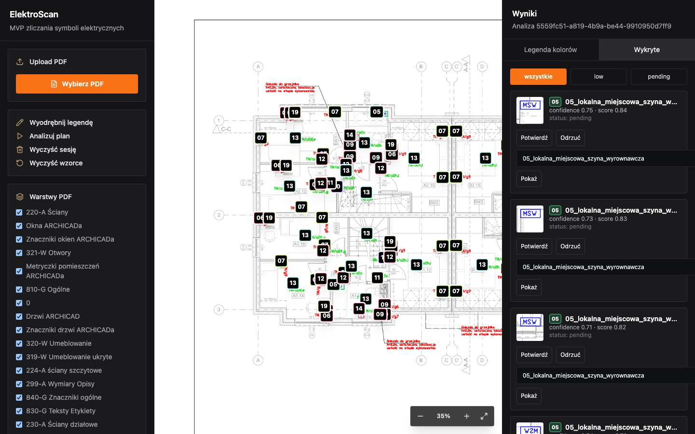

# ElektroScan

<p align="center">
  <a href="https://github.com/JakubLewosz/ElektroScan/actions/workflows/ci.yml">
    
  </a>
  
  
</p>

ElektroScan to działające w przeglądarce MVP do analizy planów elektrycznych PDF i zliczania symboli oznaczonych kolorami. Pokazuje lokalny proces od przesłania PDF i odczytania legendy po analizę obrazu i ręczną weryfikację wykrytych symboli.

> [!IMPORTANT]
> Publiczne repozytorium zawiera wcześniejszą wersję demonstracyjną ElektroScan. Znacznie bardziej rozwinięta wersja powstaje prywatnie w dwuosobowym zespole.

Ten README opisuje wyłącznie implementację dostępną w publicznym repozytorium, nie wersję prywatną.

<a id="team-and-project-origin"></a>

## Zespół i pochodzenie projektu

Pierwotny pomysł projektu zaproponował dyrektor Technikum Programistycznego INFOTECH w Białymstoku. ElektroScan był głównym projektem podczas 150-godzinnych praktyk programistycznych, realizowanych hybrydowo w szkole od 27 kwietnia do 25 maja 2026 r.

Projekt rozwija dwuosobowy zespół. Obaj członkowie dzielą odpowiedzialność za backend, frontend, analizę obrazu, testy i dokumentację.

<a id="problem-and-purpose"></a>

## Problem i cel

Zliczanie powtarzających się symboli elektrycznych na planie PDF może wymagać długiego ręcznego sprawdzania. Publiczny prototyp ElektroScan pokazuje proces, w którym użytkownik może:

- przesłać plan elektryczny w PDF;
- obejrzeć pierwszą stronę i sterować widocznością warstw PDF;
- wyodrębnić wzorce symboli z legendy;
- uruchomić analizę z informacją o postępie;
- sprawdzić, zatwierdzić, odrzucić lub przeklasyfikować wykrycia;
- dodać wykrycia ręcznie i wykluczyć wybrane obszary planu.

<a id="what-the-public-version-demonstrates"></a>

## Funkcje publicznej wersji

- Przesyłane PDF, wzorce i stan analizy rozdzielone według sesji.
- Renderowanie pierwszej strony PDF w 300 DPI za pomocą PyMuPDF.
- Odczyt legendy i zapasowe dopasowanie wzorców na podstawie kolorowych pikseli, z użyciem OpenCV i NumPy.
- Skalibrowana ścieżka referencyjna dla dołączonego planu przykładowego.
- Endpointy REST oraz Server-Sent Events do przekazywania postępu i wyników analizy.
- Interaktywny widok planu z przesuwaniem, powiększaniem, warstwą wykryć, obszarami wykluczonymi i ręcznymi zaznaczeniami.
- Lokalny zapis stanu weryfikacji, powiązany z sesją i analizą.
- Automatyczne sprawdzenia backendu, frontendu, przeglądarki, benchmarku i budowania kontenerów.

<a id="public-version-screenshot"></a>

## Zrzut publicznej wersji



Zrzut pokazuje interfejs publicznej wersji demonstracyjnej. Teksty aplikacji są po polsku.

<a id="architecture"></a>

## Architektura

- **Frontend — `frontend/`:** aplikacja React i TypeScript, budowana przez Vite i stylowana Tailwind CSS. Obsługuje przesyłanie pliku i weryfikację, rysuje interaktywny plan i zapisuje stan weryfikacji w przeglądarce.
- **Backend — `backend/`:** serwis FastAPI i Pydantic do renderowania PDF, obsługi warstw, zarządzania wzorcami legendy, analizy i przechowywania plików według sesji.
- **Analiza — `backend/core/`:** PyMuPDF renderuje plan; OpenCV i NumPy wspierają odczyt legendy i zapasowe dopasowanie wzorców. Postęp i wyniki trafiają do frontendu przez Server-Sent Events.
- **Dane referencyjne — `backend/samples/`:** dołączony PDF ma pliki wzorcowej legendy, oczekiwanych zliczeń, kontekstu i skalibrowanych obszarów referencyjnych, wykorzystywane w benchmarku regresyjnym.
- **Jakość i środowisko:** pytest, Ruff, Black, mypy, Playwright, Docker Compose, GitHub Actions i skrypt weryfikacji całego repozytorium.
- **Specyfikacje — `openspec/`:** aktualne wymagania i planowane zmiany zapisane w OpenSpec.

<a id="technologies"></a>

## Technologie

| Obszar | Technologie |
| --- | --- |
| Backend i API | Python 3.12, FastAPI, Pydantic, Uvicorn, Server-Sent Events |
| Analiza obrazu i dokumentów | OpenCV, PyMuPDF, NumPy |
| Frontend | React, TypeScript, Vite, Tailwind CSS |
| Testy i jakość | pytest, Ruff, Black, mypy, Playwright |
| Środowisko i dokumentacja | Docker Compose, GitHub Actions, OpenSpec |

<a id="current-public-limitations"></a>

## Ograniczenia publicznej wersji

- MVP jest dostrojone do konkretnego pliku referencyjnego [`backend/samples/plan.pdf`](./backend/samples/plan.pdf), a nie do dowolnych planów elektrycznych.
- Przy analizie dokładnie tego pliku backend korzysta ze skalibrowanego profilu referencyjnego. Zaakceptowany wynik **134 wykryć dotyczy wyłącznie tego przykładu**. Nie jest miarą dokładności, precyzji, czułości ani ogólnej skuteczności.
- Automatyczny odczyt legendy zwraca obecnie 19 wzorców z 22 wzorcowych wierszy legendy. Zachowanie wszystkich 22 wierszy pozostaje zadaniem do dalszej kalibracji.
- Inne PDF korzystają z zapasowego dopasowania wzorców OpenCV. Jego działanie jest nadal kalibrowane; projekt nie deklaruje ogólnej jakości wykrywania.
- Przetwarzana jest tylko pierwsza strona przesłanego PDF.
- Dane robocze są zapisywane w lokalnych katalogach sesji. Publiczne repozytorium nie ma systemu kont, trwałego zapisu w bazie danych ani konfiguracji wdrożenia produkcyjnego.
- Publiczny interfejs jest po polsku.

<a id="setup"></a>

## Uruchomienie

<a id="prerequisites"></a>

### Wymagania

- Docker z Docker Compose albo
- Python 3.12 i Node.js 22 do instalacji ręcznej — te wersje są używane przez CI i obrazy Docker.

### Docker Compose

```bash
git clone https://github.com/JakubLewosz/ElektroScan.git
cd ElektroScan
docker compose up -d --build
```

Po uruchomieniu:

- frontend: <http://127.0.0.1:5174/>;
- endpoint stanu backendu: <http://127.0.0.1:8010/api/health>.

Zatrzymanie lokalnych usług:

```bash
docker compose down
```

<a id="manual-setup"></a>

### Instalacja ręczna

Sklonuj repozytorium, a następnie uruchom backend:

```bash
cd backend
python3.12 -m venv .venv
source .venv/bin/activate
pip install -r requirements-dev.txt
uvicorn main:app --reload --host 127.0.0.1 --port 8010
```

W drugim terminalu uruchom frontend:

```bash
cd frontend
npm ci
npm run dev -- --host 127.0.0.1 --port 5174
```

Otwórz <http://127.0.0.1:5174/> w przeglądarce.

<a id="verification-and-testing"></a>

## Weryfikacja i testy

Repozytorium udostępnia jedno polecenie lokalnej weryfikacji. Najpierw zainstaluj zależności deweloperskie backendu, pakiety frontendu i przeglądarkę Chromium dla Playwright:

```bash
cd backend
python3.12 -m venv .venv
.venv/bin/pip install -r requirements-dev.txt

cd ../frontend
npm ci
npm run test:e2e:install

cd ..
./scripts/verify.sh
```

Skrypt uruchamia kompilację backendu, Ruff, Black, mypy, pytest, benchmark planu referencyjnego, sprawdzanie typów i kompilację frontendu oraz testy end-to-end Playwright. GitHub Actions wykonuje równoważne sprawdzenia jakości i dodatkowo weryfikuje budowanie obrazów Docker.

Aby wykonać podstawowe sprawdzenie przepływu API, uruchom backend na porcie `8010` i wykonaj:

```bash
backend/.venv/bin/python scripts/api_smoke.py
```

Zapasowy detektor ma oddzielny, wolniejszy benchmark:

```bash
cd backend
.venv/bin/python fallback_benchmark.py --strict
```

Wynik benchmarku wynoszący 134 wykrycia dotyczy wyłącznie dołączonego przykładu referencyjnego. Nie wolno interpretować go jako skuteczności na innych planach.
